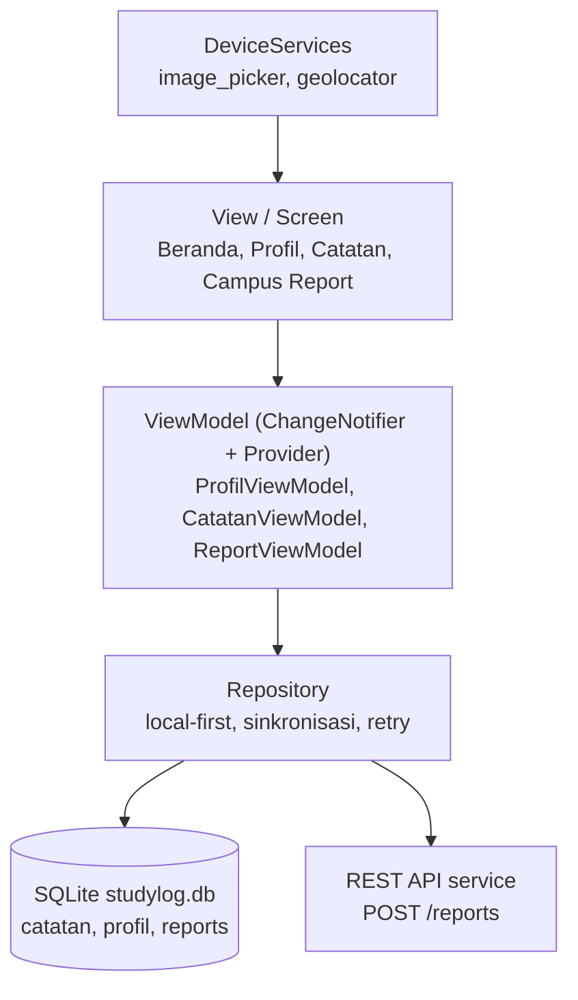

# StudyLog: Profil Mahasiswa, Catatan Kuliah, dan Campus Report

Aplikasi Flutter **offline-first** Kelompok Proxies (IFB5B), mata kuliah Pemrograman
Aplikasi Bergerak, Program Studi Informatika, Universitas Mulia.

Studi Kasus 2 melanjutkan aplikasi Profil Mahasiswa (Materi 3–5) dan StudyLog
(Milestone 1–3) menjadi **satu aplikasi**. Campus Report masuk sebagai form aduan
fasilitas kampus di aplikasi yang sama.

| Modul | Isi |
| --- | --- |
| Profil Mahasiswa | Kartu Mahasiswa + tombol Tampilkan Salam, Form Profil dengan validasi, Kontak, Detail Mata Kuliah |
| StudyLog | Tambah, lihat, ubah, hapus catatan kuliah (SQLite) |
| Campus Report | Laporan kerusakan fasilitas: foto kamera, waktu otomatis, lokasi opsional, simpan offline, kirim ke REST API, status sinkronisasi, retry tanpa duplikasi |

## Kelompok Proxies

| Nama | NIM |
| --- | --- |
| Samuel Julian Kumaat | 2411041 |
| Albert Felix Jonathan | 2411048 |
| Rizky Ariello Nesta | 2411058 |
| Muhammad Rafli | 2411073 |
| Farhan Mikdam | 2411078 |
| Desta Adha Chandra | 2411079 |

## Arsitektur



```
lib/
├── main.dart                 MultiProvider + MaterialApp (named routes)
├── routes.dart               nama route dan onGenerateRoute (pengganti NavHost)
├── models/                   catatan, profil (+ validasi), report (+ status)
├── data/                     database_helper (v2), repository tiap modul, report_local_source
├── services/                 report_api_service (http), device_services (kamera, lokasi)
├── viewmodels/               profil, catatan, report
└── screens/                  beranda, profil/, catatan, report/, tentang
backend/                      server.py (API latihan) + test_api.py
test/                         unit test model, validasi, alur sinkronisasi, widget test form
```

| Kotlin / Compose (materi) | Flutter (aplikasi ini) |
| --- | --- |
| Jetpack Compose | Flutter widgets / Material 3 |
| Room Database | sqflite (SQLite) |
| ViewModel + StateFlow | ChangeNotifier + Provider |
| Navigation Compose (NavHost, route) | Navigator + named routes (`AppRoutes`) |
| `remember { mutableStateOf() }` | `StatefulWidget` + `setState` |
| REST client Kotlin | package `http` |
| CameraX / Location | `image_picker` / `geolocator` |

### Database (`studylog.db`, versi 2)

Versi 1 (Milestone 3) hanya berisi tabel `catatan`. Versi 2 menambah `profil` dan
`reports` lewat `onUpgrade`, jadi catatan lama tidak hilang.

| Tabel | Kolom |
| --- | --- |
| `catatan` | id, mata_kuliah, judul, isi, tanggal |
| `profil` | id (selalu 1), nama, nim, prodi, status, email, telepon |
| `reports` | local_id (UUID), title, category, description, priority, photo_path, latitude, longitude, status, created_at, server_id, last_error |

### Status sinkronisasi Campus Report

```
DRAFT → PENDING → SENDING → SUCCESS
                     ↓
                  FAILED → (Coba Kirim Lagi) → PENDING → SENDING
```

- **DRAFT**: tersimpan di HP, belum diantrekan.
- **PENDING**: sudah diantrekan, menunggu dikirim.
- **SENDING**: sedang dikirim. Jika aplikasi terhenti di tahap ini, saat dibuka lagi statusnya dipulihkan menjadi FAILED.
- **SUCCESS**: server mengonfirmasi dan memberi `serverId`.
- **FAILED**: koneksi atau respons gagal. Data tidak dihapus dan bisa dikirim ulang.

`local_id` (UUID) dikirim sebagai `clientReportId`, sehingga pengiriman ulang laporan
yang sama selalu mendapat `serverId` yang sama (idempoten, tidak ada duplikasi).

## Instalasi

Prasyarat: Flutter 3.47.4 (Dart 3.13.3), Android SDK 36, NDK 28.2.13676358,
emulator Android, dan Python 3 untuk API latihan.

```powershell
git clone https://github.com/Feluxin/PAM_IFB5B_StudyLog_Proxies.git
cd PAM_IFB5B_StudyLog_Proxies
flutter pub get
flutter analyze
flutter test
```

### Menjalankan API latihan

Terminal 1:

```powershell
python backend\server.py
```

Terminal 2 (Android Emulator):

```powershell
flutter run --dart-define=API_BASE_URL=http://10.0.2.2:8000
```

`10.0.2.2` adalah alamat laptop jika dilihat dari Android Emulator. Pada HP fisik,
gunakan IP laptop di jaringan yang sama, misalnya `http://192.168.1.10:8000`.

Uji API tanpa aplikasi: `python backend\test_api.py`.

### Kendala umum

| Pesan | Solusi |
| --- | --- |
| `Could not close incremental caches` saat build | Terjadi jika proyek dan cache pub berbeda drive (misalnya D: dan C:). `android/gradle.properties` sudah berisi `kotlin.incremental=false`; jalankan `flutter clean` lalu `flutter run` |
| Laporan FAILED dengan `Network is unreachable` | Matikan mode pesawat di emulator |
| Laporan FAILED dengan `Connection refused` | Server API belum dijalankan |

> API latihan hanya untuk laboratorium: tanpa login dan tanpa HTTPS. Jangan
> mengunggah foto pribadi atau data sensitif. HTTP biasa hanya diizinkan pada build debug.

## Acceptance test

| ID | Skenario | Hasil yang diharapkan |
| --- | --- | --- |
| AT-01 | Matikan API, buat laporan | Laporan tersimpan dengan status DRAFT |
| AT-02 | Tutup aplikasi sepenuhnya, buka lagi | Laporan, catatan, dan profil masih ada |
| AT-03 | Tolak izin lokasi saat membuat laporan | Muncul pesan lokasi tidak tersedia, laporan tetap bisa disimpan |
| AT-04 | Ambil foto, simpan, tutup dan buka lagi aplikasi | Foto masih tampil di detail laporan |
| AT-05 | API mati, tekan Antrekan & Kirim | Status FAILED, pesan kesalahan tampil, data tetap ada |
| AT-06 | Jalankan API, tekan Coba Kirim Lagi | Status SUCCESS dan ID Server muncul |
| AT-07 | Kirim ulang `clientReportId` yang sama (`python backend\test_api.py`) | Server mengembalikan `serverId` yang sama, `duplicate: true` |
| AT-08 | Periksa riwayat commit dan dokumentasi | Setiap anggota punya commit; README, diagram, dan panduan lengkap |

Uji tambahan Profil Mahasiswa (Materi 3–5): tombol Simpan nonaktif saat NIM salah,
tombol Tampilkan Salam mengubah teks, navigasi Beranda → Profil → Detail Mata Kuliah →
kembali, serta data profil tetap ada setelah rotasi layar.

`flutter test` menjalankan uji otomatis untuk AT-01, AT-05, AT-06, AT-07, pemulihan
SENDING, validasi profil, dan tombol Simpan pada form profil.

## Keterbatasan

- Foto dikirim sebagai base64 di dalam JSON agar mudah dipraktikkan. Produksi sebaiknya memakai upload media terpisah dengan autentikasi dan HTTPS.
- Sinkronisasi dilakukan manual (tombol), tanpa background sync.
- Laporan yang sudah SUCCESS tidak dapat diedit.
